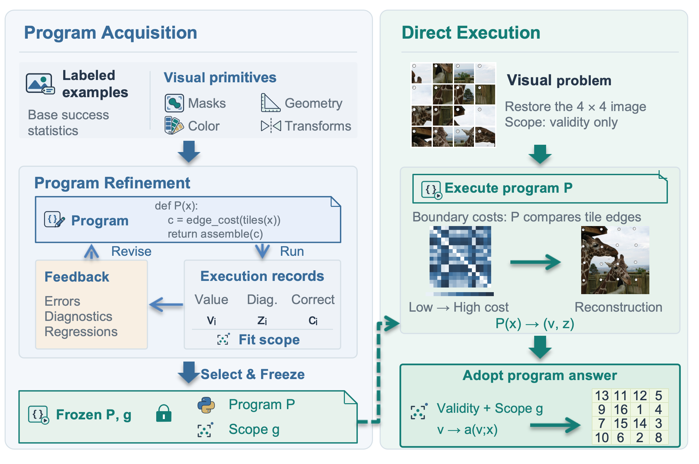

## VisualCoding — Learning executable skills for reliable agentic visual reasoning [[paper]](https://arxiv.org/abs/2610.14403)
**VisualCoding reduces hallucination errors in visual reasoning by composing visual primitives into executable programs.**



*VisualCoding overview*. **Program acquisition**: training examples, baseline statistics, and visual primitives support program search. Execution feedback guides revision, and scope fitting and selection retain a frozen program $P$ and scope $g$. **Direct execution**: valid in-scope outputs directly supply the answer through an adapter.

## Setup

```bash
bash setup_env.sh                 # python3.10 -> <repo>/.venv
cp .env.example .env              # GEMINI_API_KEY=...
```

## Data

```bash
python data/prepare_images.py --dataset all --download      # PuzzleVQA, MIRA, GameQA from the HuggingFace
python data/prepare_images.py --dataset tirbench            # after placing the TIR-Bench data/ directory at data/_raw/tirbench/data/
python data/check_images.py --pixels                        
```

Sources, split procedure and licences: `data/README.md`.

## Executor only

```bash
cd visualcoding
python -m verify.run --input ../data/tirbench/maze_test.json --model gemini-3.1-flash-lite --judge-model gemini-3.1-pro-preview \
    --judge llm --rollouts 1 --workers 8 --output-dir output/verify/demo_maze
# --system-prompt-extra <skill.md>  appends a text skill to the executor's system prompt
```

## Full method

```bash
cd visualcoding
BATCH=run1 nohup setsid bash scripts/pipeline/chain.sh tirbench:maze,tirbench:rotation_game > /dev/null 2>&1 &   # or: all | <dataset>
tail -f output/verify/run1/status.log                       # ends with "report written -> .../report.md"
```

Defaults (`scripts/pipeline/config.py`, overridable by environment variables): `EXECUTORS="flashlite pro"`, writer and judge
`gemini-3.1-pro-preview`, `PAR` families in parallel.  The run is resumable; test is measured once per family.
Outputs in `output/verify/run1/`: `report.md`, `policy_rows.jsonl`, `<family>_<TAG>.route.json`, `<run>/frozen/{code.py,rule.json,meta.json}`,
`text_skills/<dataset>__<family>/skill.md`.  Details: `visualcoding/scripts/README.md`, `visualcoding/verify/README.md`.

## Baselines

```bash
bash baselines/setup_baselines.sh                        # clone the five repos at pinned commits, apply patches, create baselines/.venvs/
bash baselines/tests/run_all.sh                          # offline tests, no API calls
cd baselines                                             # m = xskill | trace2skill | skillopt | textgrad
.venvs/<m>/bin/python  drivers/run_<m>.py    train   --families all --dry-run
.venvs/<m>/bin/python  drivers/run_<m>.py    train   --families all
../.venv/bin/python    drivers/run_gepa.py   train   --families all             # GEPA runs in the main environment
.venvs/<m>/bin/python  drivers/run_<m>.py    deploy  --families all --split test [--model gemini-3.1-flash-lite]
.venvs/<m>/bin/python  drivers/run_<m>.py    control --families all --split test [--model gemini-3.1-flash-lite]
```

## Licence

MIT (`LICENSE`).  The benchmarks keep their own licences (`data/README.md`).
